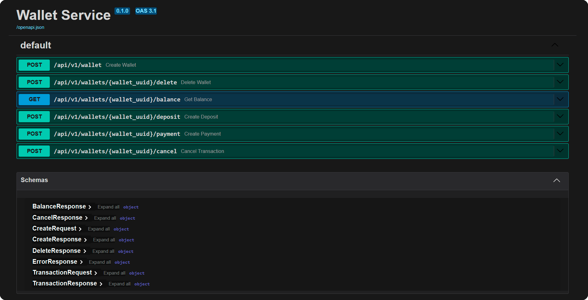

# Wallet Service

REST-сервис для работы с виртуальными кошельками. Принимает HTTP-запросы,
хранит кошельки и транзакции в PostgreSQL, работает в Docker-контейнерах.
Поддерживает базовый набор операций: создание, удаление, получение баланса,
зачисление, списание, отмену последней транзакции.
Аутентификация и шифрование данных не предусмотрены.

Проект создан как **тестовое задание** с расширенным относительно базового
Технического Задания функционалом.

---

## Стек

- **Python 3.11 slim**
- **FastAPI** — HTTP-слой, Swagger
- **SQLAlchemy 2.1.3** — ORM, синхронный
- **PostgreSQL 15.19-1** — БД
- **Alembic 1.20.0** — миграции
- **Loguru 0.7.3** — логирование
- **Docker / Docker Compose** — запуск и изоляция
- **Pytest 9.1.1** — тесты (включая конкурентные)

---

## Структура проекта

```
app/
  __init__.py
  main.py               # точка входа: создание app, подключение роутера
  logs/                 # файлы логов (main.log, test.log)
  api/
    __init__.py
    routes.py           # эндпоинты
    session.py          # engine, SessionLocal, get_db
    schemas.py          # Pydantic-схемы запросов/ответов
  exceptions/
    __init__.py
    catalog.py          # WalletError, CommonError, ServiceError
    responses.py        # словари responses для Swagger
    handlers.py         # глобальные обработчики исключений
  configs/
    __init__.py
    config.py           # загрузка .env / .testenv
    limits.py           # ActionLimits ограничения для Создания, Зачисления, Списания
    logger.py           # настройка Loguru
  db/
    __init__.py
    models.py           # SQLAlchemy-модели Wallet, Transaction
  services/
    __init__.py
    actions.py          # бизнес-логика (execute_*)
    repository.py       # доступ к БД (create_wallet, change_balance, ...)

tests/
  __init__.py
  conftest.py           # фикстуры
  test_wallets.py       # тесты

alembic/                # миграции
Dockerfile
docker-compose.yml          # для production-режима
docker-compose.test.yml     # для тестирования (запуска автоматических тестов)
run_prod.ps1                # локальный запуск production-режима
run_test.ps1                # локальный запуск тестов
.env.example
.testenv.example
requirements.txt
```

---

## Требования

- **Docker Desktop** (проверено на 4.94.0)
- **PowerShell** (опционально, для скриптов `run_*.ps1`)

Тестирование проводилось в Docker-контейнерах под Windows 11.

---

## Переменные окружения

Сервис использует два файла переменных:

- **`.env`** — production
- **`.testenv`** — тесты

Оба файла **не коммитятся** в репозиторий. В репозитории лежат шаблоны
`.env.example` и `.testenv.example` — скопируйте их. В файлах примеров записаны
все необходимые для тестирования параметры, но при необходимости вы можете их изменить.

Команды копирования для Linux:

```bash
cp .env.example .env
cp .testenv.example .testenv
```
Команды копирования для Windows:

```cmd
copy .env.example .env
copy .testenv.example .testenv
```

---

## Запуск

### Production

```bash
docker compose -f docker-compose.yml up -d
```

**Что делает:**

- Собирает образ (если нужно).
- Поднимает `db` (PostgreSQL), `alembic` (применяет миграции), `web` (сервис).
- Swagger: **http://localhost:8000/docs**

Остановка:

```bash
docker compose -f docker-compose.yml down
```

### Тесты

```bash
docker compose -f docker-compose.test.yml run --rm test
```

**Что делает:**

- Поднимает `db_test`, ждёт `healthy`.
- Применяет миграции (`alembic upgrade head`).
- Запускает `pytest` с цветным выводом.
- Удаляет контейнер `test` после завершения.
- **Оставляет `db_test` работать** — для следующего прогона тестов.

Очистка тестовой БД:

```bash
docker compose -f docker-compose.test.yml down
```

---

## API

Все эндпоинты доступны под префиксом `/api/v1`.
Базовый URL: `http://localhost:8000`.

| Метод  | Путь                             | Назначение                  |
|---     |---                               |---                          |
| `POST` | `/wallet`                        | Создание нового кошелька    |
| `POST` | `/wallets/{wallet_uuid}/delete`  | Удаление кошелька           |
| `GET`  | `/wallets/{wallet_uuid}/balance` | Получение баланса           |
| `POST` | `/wallets/{wallet_uuid}/deposit` | Зачисление средств          |
| `POST` | `/wallets/{wallet_uuid}/payment` | Списание средств            |
| `POST` | `/wallets/{wallet_uuid}/cancel`  | Отмена последней транзакции |

### Примеры запросов

**Создание кошелька**

```bash
curl -X POST http://localhost:8000/api/v1/wallet \
  -H "Content-Type: application/json" \
  -d '{"balance": "100.00"}'
```

Ответ:

```json
{
  "status": "New wallet created",
  "wallet_uuid": "3fa85f64-5717-4562-b3fc-2c963f66afa6",
  "balance": "100.00",
  "created_at": "2026-01-01T12:00:00"
}
```

**Получение баланса**

```bash
curl http://localhost:8000/api/v1/wallets/3fa85f64-5717-4562-b3fc-2c963f66afa6/balance
```

Ответ:

```json
{
  "status": "Wallet balance",
  "wallet_uuid": "3fa85f64-5717-4562-b3fc-2c963f66afa6",
  "current_balance": "100.00"
}
```

**Зачисление**

```bash
curl -X POST http://localhost:8000/api/v1/wallets/3fa85f64-5717-4562-b3fc-2c963f66afa6/deposit \
  -H "Content-Type: application/json" \
  -d '{"amount": "50.00"}'
```

**Списание**

```bash
curl -X POST http://localhost:8000/api/v1/wallets/3fa85f64-5717-4562-b3fc-2c963f66afa6/payment \
  -H "Content-Type: application/json" \
  -d '{"amount": "-30.00"}'
```

**Отмена последней транзакции**

```bash
curl -X POST http://localhost:8000/api/v1/wallets/3fa85f64-5717-4562-b3fc-2c963f66afa6/cancel
```

**Удаление кошелька** (только при нулевом балансе)

```bash
curl -X POST http://localhost:8000/api/v1/wallets/3fa85f64-5717-4562-b3fc-2c963f66afa6/delete
```

### Ошибки

Все ошибки возвращаются в едином формате:

```json
{"detail": "Описание ошибки"}
```

Возможные коды:

- **400** — бизнес-ошибка (неверный знак операции, недостаточно средств, и т.п.).
- **404** — кошелёк не найден, нет транзакций, последняя транзакция для кошелька уже отменена.
- **422** — ошибка в отправленных данных.
- **500** — внутренняя ошибка сервера.

Полный список ошибок для каждого эндпоинта — в Swagger.

---

## Бизнес-правила

- **Создание**: начальный баланс `0` по умолчанию, не может быть отрицательным,
  не может превышать лимит `10 000 000`.
- **Удаление**: только при **нулевом балансе**. Все транзакции кошелька удаляются
  вместе с ним.
- **Зачисление**: сумма строго положительная, лимит — `1 000 000`.
- **Списание**: сумма строго отрицательная, лимит по модулю — `1 000 000`,
  баланс не может уйти в минус.
- **Отмена**: отменяется **последняя** транзакция кошелька. Повторная отмена
  той же транзакции — ошибка.
- **Конкурентность**: строки кошельков блокируются через
  `SELECT ... FOR UPDATE` — операции по одному кошельку выполняются
  последовательно, по разным — параллельно.

---

## Логирование

Логи пишутся в файлы с помощью **Loguru**:

- **`app/logs/main.log`** — production, уровень `INFO`.
- **`app/logs/test.log`** — тесты, уровень `DEBUG`.

Ротация *10 MB**, архивация: **ZIP** (`main.YYYY-MM-DD_HH-mm-ss.log.zip`).

В production-режиме в лог пишутся:

- Начало и конец сессии (при старте и остановке сервиса).
- Бизнес-ошибки (`WARNING`).
- Ошибки валидации (`WARNING`).
- Необработанные ошибки с traceback (`ERROR`).

В лог записываются только ошибки. При отсутствии ошибок файлы логов будут выглядеть примерно так:
```text
2026-10-10 03:24:18     | INFO     | --- Запуск сервиса ---
2026-10-10 03:24:19     | INFO     | --- Остановка сервиса ---
```

В test-режиме в лог пишутся:

- Начало и конец сессии (при старте и остановке сервиса).
- Вход в бизнес-функцию (`DEBUG`) 
- Выход при успехе (`DEBUG`)      
- Бизнес-ошибки (`WARNING`).
- Ошибки валидации (`WARNING`).
- Необработанные ошибки с traceback (`ERROR`).

Пример части «тестового» лога:
```text
2026-10-11 06:35:46     | INFO     | --- Запуск сервиса (test) ---
2026-10-11 06:35:46.774 | DEBUG    | app.services.actions   :execute_wallet          :19 | execute_wallet: Создание кошелька, initial_balance = 100
2026-10-11 06:35:46.776 | DEBUG    | app.services.actions   :execute_wallet          :30 | execute_wallet: Успешно, wallet_uuid: 966ab985-59f9-4de2-ab06-1d0e557bf1fd, balance = 100.00
2026-10-11 06:35:46.779 | DEBUG    | app.services.actions   :execute_delete          :42 | execute_delete: Удаление кошелька, wallet_uuid: 966ab985-59f9-4de2-ab06-1d0e557bf1fd
2026-10-11 06:35:46.781 | WARNING  | app.exceptions.handlers:service_error_handler   :13 | Бизнес-ошибка [400]: Для удаления кошелька баланс должен быть нулевым
2026-10-11 06:35:46.886 | WARNING  | app.exceptions.handlers:validation_error_handler:39 | Ошибочные данные [422]: create_deposit, ('body', 'amount'): Field required
2026-10-11 06:35:47     | INFO     | --- Остановка сервиса (test) ---
```

Каталог `app/logs` примонтирован как volume — логи сохраняются
на хосте и переживают пересоздание контейнера.

---

## Swagger

После запуска production-режима документация доступна по адресу:

**http://localhost:8000/docs**



---

## Тесты

Тесты лежат в папке `tests/` и запускаются в отдельном контейнере
(`docker-compose.test.yml`). Используется тестовая БД, PostgreSQL.
К рабочей БД тесты не обращаются 

Покрытие:

- Успешные сценарии всех эндпоинтов.
- Граничные значения (лимиты, нулевой баланс).
- Ошибки: отрицательный баланс, недостаточно средств, неверный знак суммы,
  невалидный UUID, отсутствие обязательных полей, кошелёк не найден,
  нет транзакций, повторная отмена.
- **Конкурентные** сценарии: параллельные списания, списание+зачисление,
  операции по разным кошелькам, удаление+зачисление. Проверяют корректность
  построчной блокировки.

Запуск:

```bash
docker compose -f docker-compose.test.yml run --rm test
```
---

## Контакты

## Вадим Голов

- **e-mail: ve-golov@yandex.ru**
- **Telegram: https://t.me/Vegas_Real**
- **телефон: +7 922 227-72-01**